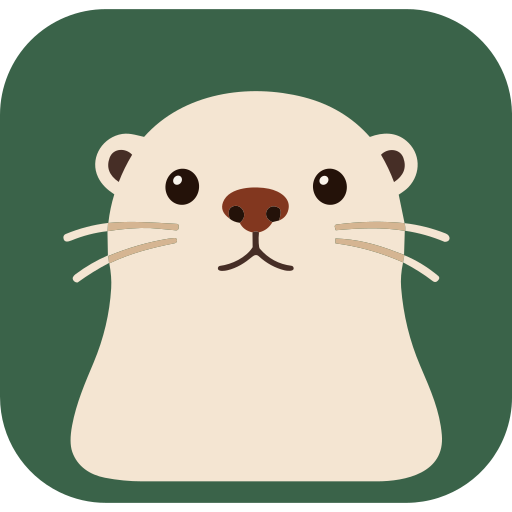

<p align="center">
  
</p>

<h1 align="center">OtterCut</h1>

<p align="center">
  <strong>从录屏到剪辑，一套工作流完成。</strong><br>
  在同一个 Rust 原生应用里采集屏幕、整理素材、编辑时间线、生成字幕并导出视频。
</p>

<p align="center">
  面向 Windows、macOS 和 Linux。Windows 11 可从源码运行，macOS 与 Linux 提供移植预览代码。
</p>

<p align="center">
  
  <a href="#平台支持"></a>
  <a href="LICENSE"></a>
</p>

## 一体化工作流

OtterCut 把录制和后期制作放在同一个工程里。录完屏后直接进入剪辑台，素材、时间线、字幕、画幅、动态背景和导出设置都围绕同一个项目保存。

<p align="center">
  <strong>录制来源 → 素材库 → 多轨时间线 → 字幕与画面处理 → 导出视频</strong>
</p>

- **录制**：选择屏幕或窗口，配置麦克风、摄像头和点击跟随效果。
- **整理**：录制结果直接进入本地素材库，也可以继续导入已有的视频、图片和音频。
- **剪辑**：在多轨时间线上完成修剪、分割、移动、吸附、框选和复制粘贴。
- **完善**：调整字幕、画幅、动态背景和画面构图，识别语音时生成可继续编辑的字幕轨。
- **交付**：在剪辑台内配置画质、分辨率、帧率、音频和背景后导出 MP4。

<p align="center">
  <a href="#快速开始"><strong>快速开始</strong></a> ·
  <a href="#功能">功能</a> ·
  <a href="#平台支持">平台支持</a> ·
  <a href="#操作参考">操作参考</a> ·
  <a href="CHANGELOG.md">更新记录</a> ·
  <a href="PROJECT_PLAN.md">项目路线图</a>
</p>

<p align="center">
  
  <br>
  <sub>OtterCut 剪辑台实拍，展示四轨演示工程。预览中的湖景为生成素材。</sub>
</p>

## 功能

### 录制

<p align="center">
  
</p>

Windows 版浮动工具条可拖动，也可收进系统托盘。录前可预览屏幕或窗口，选择麦克风并测试电平。鼠标轨迹和点击事件会随录屏一起记录，摄像头支持设备和画质选择，录像可保存为独立 MP4。

### 剪辑与构图

<table>
  <tr>
    <td width="50%" valign="top">
      <h4>多轨时间线</h4>
      拖入视频、PNG/JPG/WebP 图片或音频。静态图片默认显示 5 秒，可在时间线上继续修剪。时间线显示实际帧和波形，支持刀片、吸附、框选、复制粘贴、淡入淡出、变速、倒放、链接片段、时间线标记和撤销。
    </td>
    <td width="50%" valign="top">
      <h4>字幕与画面文字</h4>
      手动添加字幕或导入 SRT。在预览画面里拖动位置和调整大小，也可批量套用样式。
    </td>
  </tr>
  <tr>
    <td width="50%" valign="top">
      <h4>画幅与动态背景</h4>
      切换横屏、竖屏或方形画幅，搭配图片、渐变或动态背景。动画可用 <a href="动态配方.md">JSON 配方</a> 定制。
    </td>
    <td width="50%" valign="top">
      <h4>本地工程与导出</h4>
      保存 <code>.takeproj</code> 工程继续编辑，或将时间线导出为 H.264 视频与 AAC 音频的 MP4。
    </td>
  </tr>
</table>

### 鼠标与点击跟随效果

鼠标效果会在剪辑阶段实时生成，不会把效果写死在原始视频里。录制时保存的鼠标轨迹和点击事件会作为独立的 `.cursor.json` 数据使用，打开工程后可以继续调整：

- 设置效果的开始和结束时间，决定它在哪一段画面生效。
- 调整鼠标大小、点击放大倍数和跟随平滑度。
- 选择波纹、圆点或无点击反馈。
- 在时间线查看点击标记，在预览和导出中保持相同的效果位置。

### 动态背景效果

动态背景用于补足画幅空白、衬托竖屏内容或统一项目视觉。剪辑台提供网格、网点、流星、光带、光幕、波纹和光晕等预设，可以调整速度、强度、方向和焦点。背景配方以 JSON 保存，支持从面板复制给 AI 修改，再导入工程继续使用。预览和导出共用同一份配方和时间位置。

### 本地免费字幕识别

OtterCut 支持使用本地语音识别组件把视频或音频轨道转换成字幕，不需要上传素材，也不依赖云端接口或按量付费。选择媒体轨道后打开右键菜单，点击「识别语音并生成字幕」，程序会提取音频、自动检测语言并按时间戳建立字幕轨道。

- 识别结果保留原始语言，中文、英文和其他支持的语言都可以按检测结果生成。
- 每条字幕会写入对应的开始时间和持续时间，最后一句会延伸到语音结束，方便继续调整。
- 生成的字幕是时间线里的可编辑片段，可以修改文字、拖动位置、调整时长和统一样式。
- 识别过程在后台运行，底部状态栏会显示加载进度，完成后工程自动保存。

首次使用需要准备本地语音识别组件。组件放入 OtterCut 的本地应用数据目录后，程序会自动查找。识别速度取决于组件配置、处理器和显卡。

### MCP 本地桥接

项目提供独立的 `ottercut-mcp` 本地 stdio 服务，方便外部助手读取已保存工程的时间线。当前已接通 `get_timeline` 工具，可以返回工程时长、轨道、片段时间范围和字幕文本。它只读取指定的 `.takeproj` 文件，不上传工程内容。

```powershell
cargo run --locked --bin ottercut-mcp -- --project "C:\path\to\OtterCut.takeproj"
```

当前 MCP 入口面向已保存工程。实时连接编辑台、剪辑预览和应用编辑批次仍在后续接入中。

## 平台支持

| 平台与架构 | 状态 | 录制方案与适配范围 |
| --- | --- | --- |
| Windows 11 x64 | **当前验证目标** | 使用 Windows Graphics Capture 录制屏幕与窗口，可剪辑并导出 MP4。 |
| Windows 10 x64 | 目标支持，实机待验证 | 建议使用 1903（Build 18362）或更新版本。较新的 21H2、22H2 优先。 |
| Windows 32 位 | 不支持 | 当前依赖、构建目标和录屏链路均按 64 位设计。 |
| Windows ARM64 | 未验证 | 暂未提供 ARM64 构建和实机验收。 |
| macOS arm64 | 移植预览，实机待验证 | macOS 15 及以上，使用 ScreenCaptureKit 系统选择器录制屏幕或窗口，可开启默认麦克风。 |
| macOS x86_64（Intel） | 移植预览，实机待验证 | macOS 15 及以上，构建脚本支持 Intel 架构，录制链路仍需实机验收。 |
| Linux x86_64 | 移植预览，实机待验证 | GNOME Wayland 优先，通过 ScreenCast Portal 选择来源，以 PipeWire 和 GStreamer 保存 MP4。 |
| Linux ARM64 | 未验证 | 暂未提供 ARM64 的运行时和媒体插件验收。 |

Windows 10/11 和 macOS 版本均为 64 位目标。Linux 的最低发行版版本取决于桌面环境、Portal、PipeWire 和 GStreamer 版本，首发验收基线为 GNOME Wayland x86_64。

## 快速开始

### Windows 10/11 x64

1. 安装 [Rust](https://rust-lang.org/tools/install/) 的 Windows MSVC 工具链，以及 [Visual Studio Build Tools](https://visualstudio.microsoft.com/downloads/#build-tools-for-visual-studio) 的「使用 C++ 的桌面开发」工作负载与 Windows SDK。
2. 下载 [FFmpeg 的 Windows 构建](https://ffmpeg.org/download.html#build-windows)，将 `ffmpeg.exe` 和 `ffprobe.exe` 所在目录加入 `PATH`。画面文字和字幕需要支持 `libass` 的 FFmpeg 构建。
3. 打开 **x64 Native Tools Command Prompt**，运行以下命令。

```console
git clone https://github.com/muchenkezhan/OtterCut.git
cd OtterCut
cargo run --locked
```

启动后点击剪刀打开剪辑台。用左上角「文件 → 导入素材」加入本地文件，再把素材卡片拖入时间线。

点击右上角「导出」会打开剪辑台内的导出面板。可以直接输入输出路径，选择项目画幅、720p、1080p 或 4K，选择高质量、标准或小文件档位，保留或移除动态背景，开关音频，并选择 128、192 或 256 kbps 的 AAC 音频码率。当前输出格式为 MP4，默认以 30 fps 导出，导出过程支持进度和取消。

### macOS 与 Linux 移植预览

- **macOS** · 准备 Rust、带 macOS 15 或更新 SDK 的 Xcode 或命令行工具，以及含 `libass` 的 FFmpeg。开始录制时通过系统选择屏幕或窗口，并按需授予麦克风访问权限。
- **Linux** · 准备 Rust、C 编译工具、`pkg-config`、ALSA 开发库和含 `libass` 的 FFmpeg。录屏需要可用的桌面 ScreenCast Portal、PipeWire 和 `gst-launch-1.0`。GStreamer 需要 `pipewiresrc`、`x264enc`、`h264parse` 和 `mp4mux` 等插件，开启麦克风还需要 `pulsesrc` 和 AAC 编码插件。中文界面可使用 Fontconfig 和 Noto Sans CJK。

在桌面会话中运行 `cargo run --locked` 打开录制工具条。按红色录制键选择来源，再按一次停止并保存。点击编辑器图标可打开剪辑台，也可直接运行 `cargo run --locked -- --editor .`。

浮动置顶与点击跟随在 Wayland 上按桌面环境验收。macOS 与 Linux 的录制工具条使用系统来源选择器和默认麦克风。

### 语言与本地化

界面首发 **简体中文（zh-CN）** 和 **English（en-US）**。编辑台顶栏和录制工具条的设备设置面板都可以切换语言与明暗主题，选择会保存到当前用户的 OtterCut 配置目录，工程文件不会写入语言设置。首次启动会读取已保存的语言，其次读取 `OTTERCUT_LANGUAGE`、`LC_ALL`、`LANGUAGE` 或 `LANG`，无法识别时使用简体中文。

所有新增界面文案都应使用 `src/i18n.rs` 中的稳定资源键。带参数的消息使用命名占位符，例如 `{count}`，不要在界面调用点拼接半句。新增语言时同步扩展 `Language`、资源键和双语覆盖测试。

## 操作参考

<details>
<summary><strong>录制、设备与托盘</strong></summary>

- 点击屏幕图标选择录制来源和保存位置，点击红点开始录制，点击方块停止并保存。
- 点击齿轮选取麦克风和摄像头。摄像头画质由设备支持的分辨率和帧率决定。启用摄像头录制时会在主录像旁另存一个 `-摄像头.mp4` 文件。麦克风声音写入主录像。
- 点击关闭图标可隐藏工具条。左键点击托盘图标恢复工具条，右键可以打开剪辑台、重启或退出。录制中选择重启或退出会先保存录像。
- 摄像头录制需要 FFmpeg 的 DirectShow 输入和 `libx264` 编码器。也可将媒体工具放在程序同目录或 `target/tools/ffmpeg/bin`。

</details>

<details>
<summary><strong>时间线与快捷键</strong></summary>

| 操作 | 快捷键或手势 |
| --- | --- |
| 播放、暂停 | `Space` |
| 选择、刀片工具 | `V`、`C` |
| 在播放头处分割 | `Ctrl+B` |
| 复制、剪切、粘贴 | `Ctrl+C`、`Ctrl+X`、`Ctrl+V` |
| 删除选中片段 | `Delete` |
| 撤销、重做 | `Ctrl+Z`、`Ctrl+Shift+Z` |
| 缩放时间线 | `Ctrl` + 滚轮 |
| 新建轨道并放入片段 | 拖到轨道首尾空白或轨道之间 |

拖动片段边缘可修剪入点或出点。点工具角标或长按可展开波纹、滚动、滑移和滑动等编辑工具。轨道头可隐藏画面、静音或通过右键菜单删除轨道。保存工程后请保留被引用的源文件。

</details>

<details>
<summary><strong>命令行录制</strong></summary>

```powershell
cargo build --locked --bin takeseam
.\target\debug\takeseam.exe sources
.\target\debug\takeseam.exe record --display 1 --seconds 5 --output "first-take.mp4"
```

用 `sources --windows` 查看窗口标题，再通过 `record --window "窗口完整标题"` 指定窗口。用 `--mic` 启用默认麦克风，用 `--click-follow` 启用点击跟随。省略 `--seconds` 时，按 `Ctrl+C` 停止并保存。

macOS 与 Linux 预览版在桌面会话中通过系统选择器选择来源。

```sh
cargo run --locked --bin takeseam -- record --output "first-take.mp4" --mic --seconds 5
```

</details>

## 路线图与贡献

多平台适配、英文界面、AI 剪辑助手和 MCP 接入详见[项目路线图](PROJECT_PLAN.md)。欢迎 [报告问题或提出功能建议](https://github.com/muchenkezhan/OtterCut/issues)。

## 许可证

[Apache-2.0](LICENSE)
