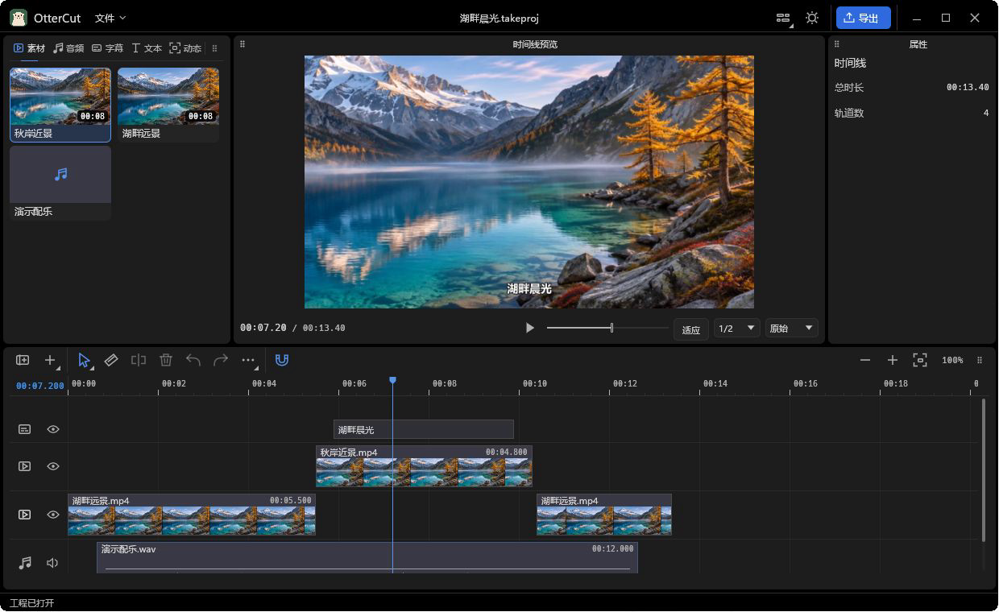

<p align="center">
  
</p>

<h1 align="center">OtterCut</h1>

<p align="center">
  <strong>用 Rust 开发的开源录屏与视频剪辑工具。</strong><br>
  录制屏幕或窗口，在多轨时间线上剪辑、加字幕，然后导出 MP4。
</p>

<p align="center">
  
  
  <a href="LICENSE"></a>
</p>

<p align="center">
  <a href="#快速开始"><strong>快速开始</strong></a> ·
  <a href="#功能">功能</a> ·
  <a href="#操作参考">操作参考</a> ·
  <a href="PROJECT_PLAN.md">项目路线图</a>
</p>

<p align="center">
  
  <br>
  <sub>OtterCut 剪辑台实拍，展示四轨演示工程。预览中的湖景为生成素材。</sub>
</p>

## 功能

### 录制

<p align="center">
  
</p>

浮动工具条可拖动，也可收进系统托盘。录前可预览屏幕或窗口，选择麦克风并测试电平。开启点击跟随后，画面会随点击位置平滑缩放。摄像头支持设备和画质选择，录像可保存为独立 MP4。

### 剪辑与构图

<table>
  <tr>
    <td width="50%" valign="top">
      <h4>多轨时间线</h4>
      拖入视频、图片或音频。时间线显示实际帧和波形，支持刀片、吸附、框选、复制粘贴和撤销。
    </td>
    <td width="50%" valign="top">
      <h4>字幕与画面文字</h4>
      手动添加字幕或导入 SRT。在预览画面里拖动位置和调整大小，也可批量套用样式。
    </td>
  </tr>
  <tr>
    <td width="50%" valign="top">
      <h4>画幅与动态背景</h4>
      切换横屏、竖屏或方形画幅，搭配图片、渐变或动态背景。动画可用 <a href="动态配方.md">JSON 配方</a> 定制。
    </td>
    <td width="50%" valign="top">
      <h4>本地工程与导出</h4>
      保存 <code>.takeproj</code> 工程继续编辑，或将时间线导出为 H.264 视频与 AAC 音频的 MP4。
    </td>
  </tr>
</table>

## 快速开始

目前桌面版支持 **Windows 11**，可从源码构建。

1. 安装 [Rust](https://rust-lang.org/tools/install/) 的 Windows MSVC 工具链，以及 [Visual Studio Build Tools](https://visualstudio.microsoft.com/downloads/#build-tools-for-visual-studio) 的「使用 C++ 的桌面开发」工作负载与 Windows SDK。
2. 下载 [FFmpeg 的 Windows 构建](https://ffmpeg.org/download.html#build-windows)，将 `ffmpeg.exe` 和 `ffprobe.exe` 所在目录加入 `PATH`。画面文字和字幕需要支持 `libass` 的 FFmpeg 构建。
3. 打开 **x64 Native Tools Command Prompt**，运行以下命令。

```console
git clone https://github.com/muchenkezhan/OtterCut.git
cd OtterCut
cargo run --locked
```

启动后点击剪刀打开剪辑台。用左上角「文件 → 导入素材」加入本地文件，再把素材卡片拖入时间线。

## 操作参考

<details>
<summary><strong>录制、设备与托盘</strong></summary>

- 点击屏幕图标选择录制来源和保存位置，点击红点开始录制，点击方块停止并保存。
- 点击齿轮选取麦克风和摄像头。摄像头画质由设备支持的分辨率和帧率决定。启用摄像头录制时会在主录像旁另存一个 `-摄像头.mp4` 文件。麦克风声音写入主录像。
- 点击关闭图标可隐藏工具条。左键点击托盘图标恢复工具条，右键可以打开剪辑台、重启或退出。录制中选择重启或退出会先保存录像。
- 摄像头录制需要 FFmpeg 的 DirectShow 输入和 `libx264` 编码器。也可将媒体工具放在程序同目录或 `target/tools/ffmpeg/bin`。

</details>

<details>
<summary><strong>时间线与快捷键</strong></summary>

| 操作 | 快捷键或手势 |
| --- | --- |
| 播放、暂停 | `Space` |
| 选择、刀片工具 | `V`、`C` |
| 在播放头处分割 | `Ctrl+B` |
| 复制、剪切、粘贴 | `Ctrl+C`、`Ctrl+X`、`Ctrl+V` |
| 删除选中片段 | `Delete` |
| 撤销、重做 | `Ctrl+Z`、`Ctrl+Shift+Z` |
| 缩放时间线 | `Ctrl` + 滚轮 |
| 新建轨道并放入片段 | 拖到轨道首尾空白或轨道之间 |

拖动片段边缘可修剪入点或出点。点工具角标或长按可展开波纹、滚动、滑移和滑动等编辑工具。轨道头可隐藏画面、静音或通过右键菜单删除轨道。保存工程后请保留被引用的源文件。

</details>

<details>
<summary><strong>命令行录制</strong></summary>

```powershell
cargo build --locked --bin takeseam
.\target\debug\takeseam.exe sources
.\target\debug\takeseam.exe record --display 1 --seconds 5 --output "first-take.mp4"
```

用 `sources --windows` 查看窗口标题，再通过 `record --window "窗口完整标题"` 指定窗口。用 `--mic` 启用默认麦克风，用 `--click-follow` 启用点击跟随。省略 `--seconds` 时，按 `Ctrl+C` 停止并保存。

</details>

## 路线图与贡献

macOS、Linux、英文界面、AI 剪辑助手和 MCP 接入已列入[项目路线图](PROJECT_PLAN.md)。欢迎 [报告问题或提出功能建议](https://github.com/muchenkezhan/OtterCut/issues)。

## 许可证

[Apache-2.0](LICENSE)
